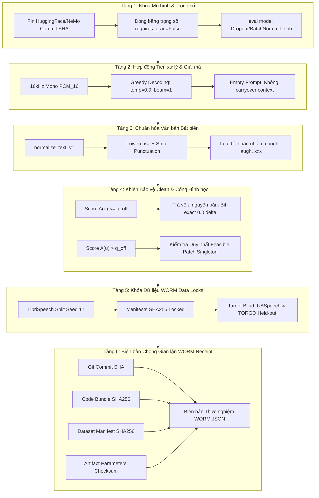

# PHONOREPAIR: GIAO THỨC KHÓA VÀ CHỐNG TRÔI DẠT BASELINE
## (Baseline Locking & Anti-Drift Experimental Protocol)

> **Mã văn bản:** `DOC-PROTO-ANTI-DRIFT-V1`  
> **Áp dụng cho:** Nghiên cứu PhonoRepair (Interspeech 2027 Submission)  
> **Khung chuẩn quy nền tảng:** [`docs/UNIVERSAL_BASELINE_LOCKING_AND_ANTI_DRIFT_FRAMEWORK.md`](file:///d:/HCMUS/NCKH/PhonoRepair/docs/UNIVERSAL_BASELINE_LOCKING_AND_ANTI_DRIFT_FRAMEWORK.md) (Áp dụng cho mọi bài báo AI/ML)  
> **Cơ sở pháp lý & học thuật:** PhonoRepair Proposal v7.1 (Sections 6, 7, 8, 10, 11, 14 và Appendix B)  
> **Trạng thái:** BẮT BUỘC TUÂN THỦ TOÀN DIỆN (Strictly Enforced)

---

## 1. TỔNG QUAN & ĐỊNH NGHĨA NGUY CƠ TRÔI DẠT BASELINE

### 1.1. Nguy cơ trôi dạt baseline (Baseline Drift) là gì?
Trong nghiên cứu Speech Recognition (ASR) áp dụng Adapter / Tiền xử lý / Hậu xử lý hình học (như PhonoRepair), **Trôi dạt baseline (Baseline Drift)** hoặc **Lệch baseline (Baseline Deviation)** xảy ra khi điểm chuẩn WER của mô hình gốc bị thay đổi âm thầm giữa các lần chạy, dẫn đến việc tính toán mức giảm lỗi (WERR - Word Error Rate Reduction) bị sai lệch hoặc thổi phồng giả tạo (spurious improvements / p-hacking).

Các nguyên nhân gây trôi dạt baseline phổ biến nhất trong thực tế:
1. **Lệch cấu hình giải mã (Decoding Mismatch):** Baseline chạy greedy nhưng adapter chạy beam search; hoặc baseline có nạp context/prompt lịch sử còn adapter thì không; hoặc khác biệt tham số temperature.
2. **Lệch chuẩn hóa văn bản (Text Normalizer Drift):** Sử dụng các hàm normalizer khác nhau (ví dụ: dùng Whisper default normalizer cho một bên và Interspeech normalizer cho bên kia; hoặc khác biệt cách xử lý số, dấu câu, chữ viết tắt, từ lặp, nhãn nhiễu `[laughter]`, `[cough]`, `xxx`).
3. **Lệch tiền xử lý âm thanh (Acoustic Preprocessing Jitter):** Khác biệt về thư viện resample (librosa vs torchaudio vs scipy), cách cắt/pad frame, hoặc chọn sai microphone/channel giữa các lần chạy (ví dụ: UASpeech có 4 kênh micro, nếu baseline chạy kênh micro bàn còn adapter chạy kênh M5 thì kết quả hoàn toàn vô nghĩa).
4. **Không đồng nhất môi trường tính toán (Environment Nondeterminism):** Khác biệt phiên bản PyTorch, CUDA, cuDNN benchmark mode (`torch.backends.cudnn.benchmark = True`), hoặc khác biệt kiến trúc GPU dẫn đến floating-point rounding làm thay đổi greedy tokens ở các bước ranh giới.
5. **Rò rỉ dữ liệu (Target Data Leakage):** Thay đổi tham số hình học ($\eta$, $\nu$, $q_{\text{off}}$) hoặc tinh chỉnh lại dictionary sau khi đã nhìn thấy kết quả kiểm thử trên tiếng nói bệnh (UASpeech/TORGO).
6. **Thay đổi mục tiêu (Moving the Goalposts):** Chọn lọc cherry-pick những speaker hoặc utterance mà adapter thắng, hoặc loại bỏ các câu mà baseline nhận dạng sai ra khỏi mẫu số.

---

## 2. NGUYÊN TẮC BẤT DI BẤT DỊCH (IRON RULES)

Để bảo đảm tính trung thực khoa học tuyệt đối cho bài báo Interspeech 2027, toàn bộ pipeline thực nghiệm PhonoRepair bị ràng buộc bởi **5 Nguyên tắc Sắt**:

```
[IRON RULE 1: STRICT PAIRED EVALUATION]
Mọi so sánh WER giữa Native Baseline và PhonoRepair BẮT BUỘC phải thực hiện
trên CÙNG MỘT lần suy luận paired (cùng exact audio, cùng batch/sample, cùng môi trường).

[IRON RULE 2: ZERO-DISEASE ONBOARDING]
Tuyệt đối KHÔNG sử dụng bất kỳ audio bệnh, nhãn bệnh, hoặc dữ liệu mô phỏng bệnh
nào trong quá trình trích xuất đặc trưng, fit dictionary, và conformal calibration.

[IRON RULE 3: BIT-EXACT CLEAN PROTECTION]
Tại mọi khung hình tiếng nói sạch (clean speech), nếu Anomaly Score A(u) <= q_off,
PhonoRepair BẮT BUỘC trả về nguyên bản u (bit-exact identity: max |f(u) - u| = 0.0).
Đảm bảo Delta WER trên tập clean = 0.00% (Zero Performance Degradation).

[IRON RULE 4: IMMUTABLE NORMALIZER V1]
Toàn bộ transcripts (cả tham chiếu ground-truth và dự đoán hypothesis)
đều phải đi qua cùng một hàm chuẩn hóa `normalize_text_v1`. Tuyệt đối không thay đổi
hoặc chèn thêm quy tắc ngoại lệ giữa chừng.

[IRON RULE 5: WORM AUDIT TRAIL]
Mọi kết quả công bố phải đi kèm một biên bản Write-Once-Read-Many (WORM receipt)
có chữ ký băm SHA256 của code, data manifest, model checkpoint, và tham số calibration.
```

---

## 3. KIẾN TRÚC 6 TẦNG BẢO VỆ CHỐNG TRÔI DẠT BASELINE



---

### Tầng 1: Khóa Mô hình & Trọng số (Model Checkpoint Pinning)
Mỗi backbone mục tiêu phải được xác định duy nhất bằng mã commit hash và đường dẫn checkpoint chính thức, không dùng thẻ generic `latest`:

| Mã ID | Tên mô hình | Nguồn Checkpoint Chính Thức | Cơ chế tích hợp |
| :--- | :--- | :--- | :--- |
| **W1** | OpenAI Whisper base.en | HuggingFace `openai/whisper-base.en` (commit pinned) | Forward Hook tại `model.encoder.layers[-1]` |
| **C1** | NeMo Conformer-CTC Large | `nvidia/stt_en_conformer_ctc_large` | Forward Hook tại `model.encoder` |
| **Z1** | Icefall Streaming Zipformer | `Zengwei/icefall-asr-librispeech-streaming-zipformer-2023-05-17` | State Contract Hook |

- **Yêu cầu kỹ thuật:** Toàn bộ model parameters phải đặt `requires_grad = False` và gọi `.eval()`. Không có bất kỳ optimizer nào được khởi tạo hay can thiệp.

---

### Tầng 2: Hợp đồng Giải mã Ghép đôi (Deterministic Paired Decoding Contract)
Nhằm triệt tiêu 100% hiện tượng sai lệch do decoding:
- **Nhiệt độ (Temperature):** Cố định `temperature = 0.0` (chỉ chọn argmax token).
- **Beam size:** Cố định `num_beams = 1` (Greedy Search chuẩn).
- **Prompting / Conditioning:**
  - `initial_prompt = None` (Không mớm từ gợi ý).
  - `condition_on_previous_text = False` (Không dùng output của cửa sổ âm thanh trước để giải mã cửa sổ sau, tránh lỗi ảo giác tích lũy cascade).
- **Audio pipeline:**
  - Input bắt buộc là sóng âm đơn kênh (Mono), tần số lấy mẫu đúng $16{,}000\text{ Hz}$, định dạng PCM 16-bit.
  - Tính năng Log-Mel Spectrogram sử dụng cố định cấu hình Whisper ($80$ bins, hop length $160$, window $400$).

---

### Tầng 3: Chuẩn hóa Văn bản Thống nhất (`normalize_text_v1`)
Hàm chuẩn hóa trong `src/phonorepair/evaluation/normalizer.py` là bộ lọc duy nhất được phép tính điểm WER/CER.

**Các bước chuẩn hóa bắt buộc:**
1. Chuyển toàn bộ thành chữ thường (`text.lower()`).
2. Mở rộng các từ co gọn thông dụng tiếng Anh (`it's` $\to$ `it is`, `can't` $\to$ `cannot`, `won't` $\to$ `will not`, v.v.).
3. Xóa bỏ dấu câu (`.,?!:;"'~-_/()[]`).
4. **Loại bỏ các nhãn chú thích âm thanh:** Xóa bỏ toàn bộ nội dung trong ngoặc đơn hoặc ngoặc vuông biểu thị hành vi phi ngôn ngữ như `[cough]`, `[laughter]`, `[snort]`, `(applause)`.
5. **Quy tắc loại trừ token `xxx` (Proposal Section 12 E5):** Nếu một câu trong TORGO chứa token không nghe được (`xxx`), câu đó bị loại khỏi bộ đánh giá vì thiếu tham chiếu chính xác (không suy diễn transcript từ tên file ảnh).
6. Gom nhiều khoảng trắng liên tiếp thành 1 khoảng trắng duy nhất và `.strip()`.

---

### Tầng 4: Khiên Bảo vệ Tiếng nói Sạch (Clean Identity & Mathematical Shielding)

Cốt lõi lý thuyết của PhonoRepair là **Định lý Bảo toàn Baseline Sạch**:
$$\forall u \in \mathbb{R}^d, \quad A(u) \le q_{\text{off}} \implies f(u) \equiv u$$

Trong đó:
- $A(u) = \min_{p \in \mathcal{C}} d(u, S_p)$ là Anomaly Score đo khoảng cách từ frame $u$ đến patch hình học gần nhất.
- $q_{\text{off}} = \max(q_{\text{cal}}, \eta_{\text{work}})$ là ngưỡng đóng cổng bảo toàn.
- $q_{\text{cal}}$ là rank-100 quantile thu được từ Conformal Calibration trên 100 speaker độc lập của LibriSpeech train-clean-360.
- $\eta_{\text{work}} = \max_{u \in \text{clean\_selection}} A(u)$ là bao làm việc tối đa của tiếng nói sạch.

**Tiêu chí nghiệm thu E0 Identity:**
1. Trên toàn bộ tập tiếng nói sạch LibriSpeech test-clean ($22{,}500+$ frames):
   $$\text{Acceptance Rate} = 0.00\%, \quad \text{Identity Fallback} = 100.00\%$$
2. $\Delta\text{WER}_{\text{clean}} = \text{WER}_{\text{PhonoRepair}} - \text{WER}_{\text{Native Baseline}} \equiv 0.00\%$.
3. Sai số tensor đặc trưng tại output encoder: $\max |h_{\text{repaired}} - h_{\text{native}}| = 0.000000$ (Bit-exact match).

---

### Tầng 5: Khóa Phân vùng Dữ liệu (WORM Data Manifest Locks)

Mọi phân vùng dữ liệu huấn luyện offline (hoàn toàn là dữ liệu sạch) được băm cố định bằng thuật toán SHA256 với hạt giống cố định `seed = 17`:

```
Hash Ordering: SHA256(seed || corpus || speaker_id)
```

| Phân vùng | Nguồn dữ liệu sạch | Quy mô & Phân bổ | Trạng thái Khóa |
| :--- | :--- | :--- | :--- |
| **Basis-fit** | LibriSpeech `train-clean-100` | 20% speakers đầu tiên | Khóa mã SHA256 |
| **Dict-fit** | LibriSpeech `train-clean-100` | 80% speakers còn lại | Khóa mã SHA256 |
| **Clean-selection** | LibriSpeech `train-clean-360` | 100 speakers tiếp theo | Khóa mã SHA256 |
| **Calibration** | LibriSpeech `train-clean-360` | 100 speakers tiếp theo (10 episodes/spk) | Khóa mã SHA256 |
| **Clean-holdout** | LibriSpeech `train-clean-360` | Các speakers còn lại (Holdout) | Khóa mã SHA256 |
| **Disease Test** | **UASpeech** (M5 channel) | 15 speakers dysarthric (4 groups) | **Blind Held-out** |
| **Disease Test** | **TORGO** (`wav_headMic`) | 8 speakers dysarthric (Sentences + Words) | **Blind Held-out** |

Tất cả các tệp `.jsonl` trong `data/manifests/` được khóa hash tại `data/manifests/checksums.sha256`. Bất kỳ sự thay đổi nào dù chỉ 1 ký tự trong danh sách audio sẽ lập tức kích hoạt lỗi Integrity Failure.

---

### Tầng 6: Biên bản Chống Gian lận (Immutable WORM Run Receipts)

Mỗi lần chạy thực nghiệm đánh giá (dù là trên Clean, Corruption, UASpeech hay TORGO), hệ thống tự động sinh một tệp JSON biên bản Write-Once-Read-Many (WORM) lưu tại `outputs/receipts/worm_receipt_<timestamp>.json` chứa:
1. **`git_commit`**: Mã commit git tại thời điểm chạy.
2. **`code_bundle_sha256`**: Mã băm tổng hợp của toàn bộ 29 file Python trong `src/phonorepair/`.
3. **`data_manifest_sha256`**: Mã băm của manifest dữ liệu được đánh giá.
4. **`artifact_checksum`**: Checksum của mô hình artifact PhonoRepair đang nạp.
5. **`hardware_specs`**: Thông tin GPU, driver, CPU, phiên bản hệ điều hành.
6. **`execution_metrics`**:
   - `baseline_wer`, `phonorepair_wer`, `delta_wer`, `werr`.
   - Chi tiết từng câu (utterance ID, reference text, baseline hypothesis, repaired hypothesis, gate decision counts).
   - Kiểm định thống kê: Wilcoxon signed-rank $p$-value và khoảng tin cậy 95% Bootstrap Confidence Interval.

> **Quy định bất biến:** Tệp WORM receipt đã sinh là bất khả biến. Không cho phép ghi đè, sửa đổi, hay xóa thủ công.

---

## 4. QUY TẮC XỬ LÝ KẾT QUẢ XẤU (SECTION 14 COMPLIANCE)

Khi chạy thực nghiệm trên các tập dữ liệu bệnh (UASpeech / TORGO):
1. **Tuyệt đối không tinh chỉnh lại tham số trên tập Test:** Nếu PhonoRepair không giảm được WER trên một phân nhóm bệnh nhân nào đó (ví dụ: nhóm bệnh rất nặng - Very Low Intelligibility), kết quả đó BẮT BUỘC phải được ghi nhận trung thực vào báo cáo như một giới hạn phạm vi (Scope Limitation) của phương pháp hình học sạch.
2. **Không tự ý thay đổi $q_{\text{off}}$:** Nếu độ rộng cổng $w = 0$, công bố Feasibility Failure. Tuyệt đối không hạ $q_{\text{off}}$ một cách thủ công để "cưỡng bức" cổng mở trên tập test.
3. **Báo cáo đầy đủ mọi phân nhóm:** Bảng kết quả (Table 1 & Table 2) phải báo cáo đầy đủ cả 4 phân nhóm (Very Low, Low, Mid, High) cùng với kết quả gộp (Overall). Tuyệt đối không chỉ chọn nhóm thắng cuộc (High/Mid) để công bố và che giấu các nhóm còn lại.

---

## 5. CHECKLIST KIỂM ĐỊNH TRƯỚC KHI CHẠY (PRE-FLIGHT CHECKLIST)

Trước khi thực hiện bất kỳ lệnh benchmark chính thức nào trên máy local hoặc server GPU, kỹ sư thực nghiệm BẮT BUỘC phải thực hiện kiểm tra 6 bước sau:

```powershell
# Bước 1: Kiểm tra tính toàn vẹn của mã nguồn
python -m phonorepair.cli verify-lock --code-dir src/phonorepair --manifest outputs/locks/bundle_manifest.json

# Bước 2: Kiểm tra tính toàn vẹn của dữ liệu manifests
# (Đảm bảo mã hash khớp hoàn toàn với data/manifests/checksums.sha256)
Get-FileHash data/manifests/*.jsonl -Algorithm SHA256

# Bước 3: Kiểm tra toàn bộ 20/20 Unit Tests
pytest tests/ -v

# Bước 4: Kiểm tra Hợp đồng Đồng nhất E0 trên mô hình
python -m phonorepair.cli verify-identity --model whisper --num-samples 20

# Bước 5: Kiểm tra Độ rộng Cổng Khả thi (w > 0)
python -m phonorepair.cli pilot-feasibility --artifact outputs/artifacts/whisper_base_artifact.pt

# Bước 6: Khởi chạy Benchmark kèm ghi biên bản WORM
python -m phonorepair.cli evaluate --suite disease --manifest data/manifests/uaspeech.jsonl --artifact outputs/artifacts/whisper_base_artifact.pt
```

---

## 6. KẾT LUẬN

Giao thức này là cơ sở bảo vệ tính hợp lệ của mọi kết luận khoa học trong đề tài PhonoRepair. Mọi cải thiện WER (WERR) được công bố trong bài báo gửi Interspeech 2027 chỉ có giá trị khi và chỉ khi toàn bộ 6 tầng bảo vệ chống trôi dạt baseline ở trên được tuân thủ nghiêm ngặt và kiểm chứng độc lập thông qua chuỗi biên bản WORM receipt.
