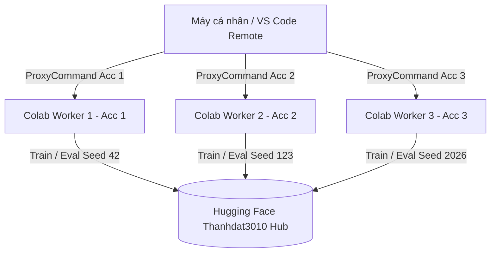

# Hướng dẫn Huấn luyện & Đánh giá NCKH trên Google Colab qua SSH (google-colab-cli)

Tài liệu này cung cấp hướng dẫn vận hành môi trường **Google Colab** phục vụ các bài toán Nghiên cứu Khoa học (huấn luyện mô hình, chạy benchmark, inference). Hướng dẫn được xây dựng dựa trên công cụ chính thức **`google-colab-cli`** và chuẩn hóa **quy trình điều phối song song 3 tài khoản Colab (3 Workers)** thông qua cơ chế OpenSSH `ProxyCommand`.

---

## 1. Khi nào nên Chọn Google Colab?

| Nền tảng | Ưu điểm chính | Kịch bản sử dụng phù hợp |
|---|---|---|
| **Máy cá nhân / Laptop** | Tiện lợi, không giới hạn thời gian chạy, miễn phí | Viết code, debug cú pháp, test logic dữ liệu, gọi LLM qua API |
| **GPU Server (RTX 6000)** | GPU mạnh (24GB VRAM), mạng nội bộ ổn định, không lo timeout | Huấn luyện chính thức, chạy benchmark dài ngày |
| **Google Colab (Pro/Pro+)** | Truy cập GPU cao cấp (A100 40GB/80GB, V100, L4) theo nhu cầu | Chạy các mô hình yêu cầu VRAM lớn, chạy song song nhiều đợt thử nghiệm, hoặc khi server trường đang bận |

> [!CAUTION]
> **Đặc tính vòng đời của Colab Runtime:**
> - Máy ảo Colab là **tạm thời (ephemeral)**. Runtime có thể bị ngắt kết nối hoặc thu hồi khi hết thời gian chờ (idle timeout), vượt quá giới hạn giờ liên tục (thường 12h–24h), hoặc hết Compute Units.
> - **Nguyên tắc bắt buộc:** Luôn lưu checkpoint thường xuyên và tải kết quả/artifacts về máy cá nhân hoặc đẩy thẳng lên Hugging Face Hub.

---

## 2. Công cụ Quản lý: `google-colab-cli`

Hệ thống sử dụng công cụ CLI chính thức của Colab:
- Đường dẫn thực thi: `colab` (hoặc `C:\Users\Lenovo\miniconda3\Scripts\colab.exe`).
- Cơ chế SSH: `colab.exe ssh --proxy-mode` hoạt động như một cầu nối `ProxyCommand` truyền tải SSH qua WebSocket nguyên bản của Google Colab, **không cần cài đặt các giải pháp tunnel bên thứ ba (như cloudflared, ngrok hay colab-ssh)**.

### Các lệnh cốt lõi của CLI:

```powershell
# 1. Quản lý phiên (Session)
colab new -s <session_name> --gpu A100    # Cấp phát máy ảo mới kèm GPU (A100, V100, T4, L4)
colab sessions                           # Liệt kê tất cả các phiên đang hoạt động
colab status -s <session_name>           # Xem trạng thái phần cứng và tài nguyên phiên
colab stop -s <session_name>             # Dừng và giải phóng máy ảo để tiết kiệm Compute Units

# 2. Quản lý tệp tin
colab upload -s <session_name> <local_path> <remote_path>      # Tải file lên máy ảo
colab download -s <session_name> <remote_path> <local_path>    # Tải file/log từ máy ảo về máy cá nhân
colab ls -s <session_name> <remote_path>                       # Liệt kê file trên máy ảo

# 3. Theo dõi & Tài nguyên
colab usage                              # Kiểm tra số lượng Compute Units còn lại
```

---

## 3. Kiến trúc & Cấu hình Điều phối 3 Tài khoản Colab Song song

Hệ thống trên máy đã được cấu hình sẵn 3 thư mục profile độc lập cho 3 tài khoản Google Colab:
- **Tài khoản 1 (Mặc định):** `C:\Users\Lenovo\.config\colab-cli\sessions.json`
- **Tài khoản 2:** `C:\Users\Lenovo\.colab_acc2\.config\colab-cli\sessions.json`
- **Tài khoản 3:** `C:\Users\Lenovo\.colab_acc3\.config\colab-cli\sessions.json`



### 3.1. Cấu hình SSH Host trong `~/.ssh/config`

Để mở 3 cửa sổ VS Code Remote SSH hoặc 3 tab terminal kết nối trực tiếp vào 3 máy ảo cùng lúc mà không bị đá phiên, khai báo trong file `C:\Users\Lenovo\.ssh\config`:

```ssh
# ==========================================
# COLAB WORKER 1 (Tài khoản 1 - Mặc định)
# ==========================================
Host colab-acc1
  HostName colab-runtime-1
  User root
  ProxyCommand C:/Users/Lenovo/miniconda3/Scripts/colab.exe --config C:/Users/Lenovo/.config/colab-cli/sessions.json ssh --proxy-mode -s colab_acc1
  StrictHostKeyChecking no
  UserKnownHostsFile /dev/null

# ==========================================
# COLAB WORKER 2 (Tài khoản 2)
# ==========================================
Host colab-acc2
  HostName colab-runtime-2
  User root
  ProxyCommand C:/Users/Lenovo/miniconda3/Scripts/colab.exe --config C:/Users/Lenovo/.colab_acc2/.config/colab-cli/sessions.json ssh --proxy-mode -s colab_acc2
  StrictHostKeyChecking no
  UserKnownHostsFile /dev/null

# ==========================================
# COLAB WORKER 3 (Tài khoản 3)
# ==========================================
Host colab-acc3
  HostName colab-runtime-3
  User root
  ProxyCommand C:/Users/Lenovo/miniconda3/Scripts/colab.exe --config C:/Users/Lenovo/.colab_acc3/.config/colab-cli/sessions.json ssh --proxy-mode -s colab_acc3
  StrictHostKeyChecking no
  UserKnownHostsFile /dev/null
```

> [!TIP]
> Sau khi cấu hình xong, bạn chỉ cần mở VS Code, nhấn `Ctrl+Shift+P` $\rightarrow$ `Remote-SSH: Connect to Host...` và chọn `colab-acc1`, `colab-acc2`, hoặc `colab-acc3`.

---

### 3.2. Script PowerShell Điều phối 3 Tài khoản

Bạn có thể lưu các hàm tiện ích này vào PowerShell Profile (`$PROFILE`) để quản lý nhanh:

```powershell
# Đường dẫn config 3 tài khoản
$global:ColabConfigs = @{
    1 = "C:\Users\Lenovo\.config\colab-cli\sessions.json"
    2 = "C:\Users\Lenovo\.colab_acc2\.config\colab-cli\sessions.json"
    3 = "C:\Users\Lenovo\.colab_acc3\.config\colab-cli\sessions.json"
}

# Hàm chạy lệnh colab theo account ID (1, 2, 3)
function Invoke-ColabAcc {
    param(
        [Parameter(Mandatory=$true)][ValidateSet(1,2,3)][int]$Acc,
        [Parameter(Mandatory=$true, ValueFromRemainingArguments=$true)][string[]]$ArgsList
    )
    $cfg = $global:ColabConfigs[$Acc]
    & "C:\Users\Lenovo\miniconda3\Scripts\colab.exe" --config $cfg @ArgsList
}

# 1. Khởi tạo 3 worker cùng lúc
function Start-ColabCluster {
    param([string]$Gpu = "A100")
    Write-Host "[*] Khởi tạo Worker 1..." -ForegroundColor Cyan
    Invoke-ColabAcc 1 new -s colab_acc1 --gpu $Gpu
    Write-Host "[*] Khởi tạo Worker 2..." -ForegroundColor Cyan
    Invoke-ColabAcc 2 new -s colab_acc2 --gpu $Gpu
    Write-Host "[*] Khởi tạo Worker 3..." -ForegroundColor Cyan
    Invoke-ColabAcc 3 new -s colab_acc3 --gpu $Gpu
}

# 2. Xem trạng thái cả 3 worker
function Get-ColabClusterStatus {
    1..3 | ForEach-Object {
        Write-Host "`n--- Trạng thái Worker $_ ---" -ForegroundColor Yellow
        Invoke-ColabAcc $_ status
    }
}

# 3. Dừng cả 3 worker giải phóng Compute Units
function Stop-ColabCluster {
    Invoke-ColabAcc 1 stop -s colab_acc1
    Invoke-ColabAcc 2 stop -s colab_acc2
    Invoke-ColabAcc 3 stop -s colab_acc3
    Write-Host "[✓] Đã dừng toàn bộ 3 máy ảo Colab." -ForegroundColor Green
}
```

---

### 3.3. Ma trận Phân bổ Thực nghiệm (Workload Matrix)

| Chiến lược | Worker 1 (Acc 1) | Worker 2 (Acc 2) | Worker 3 (Acc 3) |
|---|---|---|---|
| **Chiến lược A: Đa Seeds (Khuyên dùng)** | Chạy `seed-42` | Chạy `seed-123` | Chạy `seed-2026` |
| **Chiến lược B: So sánh Phương pháp** | Chạy Baseline Model | Chạy Phương pháp đề xuất | Chạy Biến thể Ablation / Model khác |
| **Chiến lược C: Chia nhỏ Benchmark** | Đánh giá Split 1 (0%–33%) | Đánh giá Split 2 (34%–66%) | Đánh giá Split 3 (67%–100%) |

### 3.4. Đẩy Checkpoints Song song lên Hub (Không xung đột)

Do hệ thống lưu trữ phân cấp theo cấu trúc:
`checkpoints/<dataset>/<backbone>/<method>/seed-<seed>/`

- **Worker 1** đẩy vào: `.../seed-42/`
- **Worker 2** đẩy vào: `.../seed-123/`
- **Worker 3** đẩy vào: `.../seed-2026/`

Vì các subpath hoàn toàn độc lập, **cả 3 Worker có thể chạy script `upload_checkpoint.py` song song cùng lúc** lên cùng repo `Thanhdat3010/<project_name>-checkpoints` mà không bao giờ bị ghi đè hoặc xung đột Git LFS.

---

## 4. Thiết lập Môi trường trên từng Worker

Sau khi đã SSH vào worker (`ssh colab-acc1`, `ssh colab-acc2`, hoặc `ssh colab-acc3`):

### 4.1. Kiểm tra Tài nguyên ban đầu

```bash
nvidia-smi
df -h /content
python3 --version
```

### 4.2. Cấu trúc Thư mục & Chuyển hướng Cache

Tạo thư mục làm việc cho dự án tại `/content/<project_name>`:

```bash
export PROJECT_NAME="<project_name>"
mkdir -p /content/$PROJECT_NAME
cd /content/$PROJECT_NAME

# Tạo các thư mục cần thiết
mkdir -p cache/huggingface cache/torch cache/pip tmp logs data outputs checkpoints

# Chuyển hướng toàn bộ cache về thư mục dự án
export HF_HOME="/content/$PROJECT_NAME/cache/huggingface"
export TORCH_HOME="/content/$PROJECT_NAME/cache/torch"
export PIP_CACHE_DIR="/content/$PROJECT_NAME/cache/pip"
export TMPDIR="/content/$PROJECT_NAME/tmp"
export TOKENIZERS_PARALLELISM=false
```

### 4.3. Cài đặt Thư viện & Biến Môi trường An toàn

```bash
# Cài đặt requirements
pip install -r requirements.txt

# Nạp token Hugging Face và API keys an toàn (không hiển thị ký tự khi gõ)
read -rsp 'HUGGINGFACE_TOKEN: ' HF_TOKEN; echo ""; export HF_TOKEN
```

---

## 5. Quy trình Chạy Thực nghiệm

### Bước 1: Smoke Test
```bash
cd /content/<project_name>
python scripts/run_experiment.py --mode test --limit 16 --batch_size 8 --output_dir outputs/smoke_test --device cuda
```

### Bước 2: Chạy Thực nghiệm Chính thức trong Tiến trình Nền
Do kết nối mạng có thể bị gián đoạn, luôn chạy qua `nohup`:

```bash
cd /content/<project_name>

# Worker 1 chạy với seed 42 (hoặc cấu hình tương ứng của worker)
nohup python -u scripts/run_experiment.py \
  --config configs/train_config.yaml \
  --seed 42 \
  --output_dir outputs/run_seed42 \
  > logs/run_seed42.log 2>&1 &

echo $! > logs/run_seed42.pid
tail -f -n 40 logs/run_seed42.log
```

---

## 6. Thu thập Kết quả & Dọn dẹp

### 6.1. Tải Kết quả về Máy cá nhân
```powershell
# Tải kết quả từ Worker 1
Invoke-ColabAcc 1 download -s colab_acc1 /content/<project_name>/outputs/run_seed42 ./results/run_seed42

# Hoặc đẩy trực tiếp từ máy ảo Colab lên Hugging Face Hub (Khuyên dùng)
# python scripts/hf/upload_checkpoint.py ...
```

### 6.2. Dừng Máy ảo Sau khi Hoàn thành
```powershell
# Dừng cụm 3 worker
Stop-ColabCluster
```

---

## 7. Tài liệu Liên quan

- [Hướng dẫn Vận hành GPU Server RTX 6000](RTX6000_TAILSCALE_RUNBOOK.md)
- [Quy chuẩn Lưu trữ Checkpoint trên Hugging Face (Thanhdat3010)](HUGGINGFACE_CHECKPOINT_STORAGE.md)
