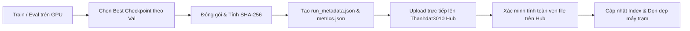

# Quy chuẩn Quản lý & Lưu trữ Checkpoints NCKH trên Hugging Face (Tài khoản Thanhdat3010)

Tài liệu này định nghĩa quy chuẩn chung về việc lưu trữ, quản lý phiên bản và đồng bộ mô hình (checkpoints), bộ dữ liệu kết quả và metadata thực nghiệm cho dự án trên Hugging Face Hub dưới tài khoản cá nhân: **`Thanhdat3010`** (URL: `https://huggingface.co/Thanhdat3010`).

---

## 1. Nguyên tắc Cốt lõi & Cấu hình Tài khoản

1. **Tài khoản Đích (Target Account):**
   - Tài khoản lưu trữ: **`Thanhdat3010`** (`https://huggingface.co/Thanhdat3010`).
   - Cú pháp repository: `Thanhdat3010/<project_name>-checkpoints` (ví dụ cho dự án này: `Thanhdat3010/PhonoRepair-checkpoints`).
2. **Cấu hình Token Xác thực (HF Token):**
   - Biến môi trường: `HF_TOKEN`
   - Nạp biến môi trường trên Linux / Colab / RTX 6000:
     ```bash
     export HF_TOKEN="<YOUR_HF_TOKEN>"
     ```
   - Nạp trên Windows PowerShell:
     ```powershell
     $env:HF_TOKEN = "<YOUR_HF_TOKEN>"
     ```
   - Hoặc lưu vào file `.env` tại thư mục gốc dự án:
     ```text
     HF_TOKEN=<YOUR_HF_TOKEN>
     HF_USERNAME=Thanhdat3010
     ```
3. **Chỉ Lưu Checkpoint Đạt Chuẩn (Chất lượng > Số lượng):**
   - **Chỉ lưu checkpoint tốt nhất (`best.zip` hoặc `best_model/`)** được lựa chọn dựa trên tập **Validation** (theo tiêu chí định lượng đã khóa trước như `val_loss`, `val_f1`, `val_bleu`, `val_wer`).
   - **Tuyệt đối không dùng tập Test để chọn checkpoint**.
   - Hạn chế tối đa việc tải lên toàn bộ mọi epoch hoặc checkpoint trung gian (intermediate checkpoints) gây lãng phí dung lượng Hub.
4. **Upload Trực tiếp từ Máy tính toán (Direct Upload):**
   - Upload trực tiếp từ GPU Server (RTX 6000) hoặc Colab lên Hugging Face Hub qua Python SDK (`huggingface_hub`).
   - Không cần tải hàng chục GB weights về máy laptop cá nhân để trung chuyển.
5. **Tính Tái lập & Truy vết (Reproducibility & Provenance):**
   - Mỗi checkpoint bắt buộc phải đi kèm tệp mô tả thông số huấn luyện (`run_metadata.json`), kết quả định lượng (`metrics.json`), và dự đoán chi tiết (`predictions.*`).

---

## 2. Cấu trúc Thư mục Chuẩn trên Hub

Cấu trúc cây thư mục bên trong repo `Thanhdat3010/<project_name>-checkpoints` được chuẩn hóa theo phân cấp:

```text
Thanhdat3010/<project_name>-checkpoints/
├── README.md                                  # Giới thiệu dự án, bảng leaderboard tóm tắt
├── registry/                                  # Quản lý mục lục và chỉ mục toàn repo
│   ├── checkpoint_index.json                  # Danh mục máy đọc (JSON)
│   ├── checkpoint_index.csv                   # Danh mục bảng tính (CSV) để lọc
│   └── README.md                              # Bảng tổng hợp kết quả chi tiết
│
└── checkpoints/                               # Thư mục gốc chứa weights
    └── <dataset_or_benchmark>/                # Tên bộ dữ liệu (vd: phonorepair_bench_v1, uaspeech)
        └── <backbone_model>/                  # Tên kiến trúc gốc (vd: whisper-base, zipformer, conformer)
            └── <method_name>/                 # Tên phương pháp đề xuất / baseline
                └── seed-<seed_number>/        # Seed ngẫu nhiên (vd: seed-42, seed-123)
                    └── [<configuration>/]     # (Tùy chọn) Chỉ thêm nếu cùng seed có nhiều biến thể
                        ├── best.zip           # Trọng số mô hình tốt nhất (hoặc safetensors)
                        ├── run_metadata.json  # Metadata bắt buộc: cấu hình, git commit, SHA-256
                        ├── metrics.json       # Báo cáo các chỉ số định lượng
                        ├── validation_predictions.jsonl (hoặc .csv)
                        ├── test_metrics.json
                        ├── test_predictions.jsonl
                        └── training_receipt.json   # Log chi tiết hyperparams và lịch sử loss
```

### Bảng Giải thích các Thành phần

| Thành phần | Quy tắc đặt tên | Ví dụ minh họa |
|---|---|---|
| `<dataset>` | Chữ thường, gạch dưới, kèm phiên bản nếu có | `phonorepair_bench_v1`, `librispeech_clean` |
| `<backbone>` | Tên chuẩn của mô hình nền trên HF | `whisper-base.en`, `zipformer`, `conformer-ctc` |
| `<method>` | Tên phương pháp đề xuất hoặc baseline so sánh | `baseline`, `phonetic_adapter`, `latent_repair` |
| `seed-<seed>` | `seed-<số>` để phân định các lần chạy lặp lại | `seed-42`, `seed-123`, `seed-2026` |
| `<config>` | *(Tùy chọn)* Chỉ dùng khi cùng seed có biến thể tham số | `r64_s2`, `affine_full` |
| `best.zip` | Archive chứa trọng số đã chọn | File nén `pytorch_model.bin` hoặc `*.safetensors` |

---

## 3. Quy chuẩn Tệp Metadata (`run_metadata.json`)

Mọi thư mục checkpoint bắt buộc phải có tệp `run_metadata.json` với định dạng chuẩn sau:

```json
{
  "project_name": "PhonoRepair",
  "task": "dysarthric_speech_latent_repair",
  "dataset": {
    "name": "phonorepair_bench_v1",
    "split_info": "train: 20000, val: 2000, test: 2000",
    "hash_sha256": "a3f5c789b1c2..."
  },
  "model": {
    "backbone": "openai/whisper-base.en",
    "backbone_revision": "main",
    "method": "latent_geometric_repair"
  },
  "training": {
    "seed": 42,
    "learning_rate": 5e-5,
    "batch_size_per_device": 16,
    "gradient_accumulation_steps": 2,
    "effective_batch_size": 32,
    "precision": "fp16",
    "max_epochs": 10,
    "early_stopping_patience": 3,
    "best_epoch": 7,
    "best_step": 4375,
    "selection_criterion": "val_wer"
  },
  "environment": {
    "gpu_name": "NVIDIA Quadro RTX 6000",
    "cuda_version": "11.8",
    "torch_version": "2.2.0",
    "transformers_version": "4.38.2",
    "git_commit_sha": "d4e7a8123456789abcdef..."
  },
  "artifact": {
    "file_name": "best.zip",
    "file_size_bytes": 2445892301,
    "archive_sha256": "9b1c2d3e4f5a6b7c8d9e0f1a2b3c4d5e6f7a8b9c..."
  },
  "timestamp": "2026-10-17T20:00:00Z"
}
```

---

## 4. Quy trình Upload và Đồng bộ Trực tiếp (Step-by-Step)



1. **Khóa kết quả Validation:** Chọn checkpoint có điểm Validation cao nhất theo tiêu chí đã đặt ra.
2. **Đóng gói Trọng số:** Nén thư mục trọng số mô hình thành file `best.zip` (hoặc giữ nguyên định dạng `.safetensors` chuẩn của Hugging Face).
3. **Tính toán Băm Toàn vẹn:** Tính mã SHA-256 của file trọng số để đưa vào `run_metadata.json`.
4. **Tải lên Hub:** Sử dụng `huggingface_hub.HfApi` để upload toàn bộ các file của run vào đúng đường dẫn phân cấp trên repo `Thanhdat3010/<project_name>-checkpoints`.
5. **Kiểm tra Xác thực:** Đối chiếu kích thước và commit hash trên Hub để chắc chắn upload không bị đứt đoạn.
6. **Dọn dẹp Tài nguyên Máy chủ:** Sau khi file đã an toàn trên Hub, xóa file tạm trên GPU server/Colab để giải phóng ổ cứng.

---

## 5. Bộ Scripts Python Mẫu Dùng Chung (Reusable Tooling)

Dưới đây là các script mẫu chuẩn bằng Python sử dụng thư viện `huggingface_hub`. Bạn có thể lưu các script này vào thư mục `scripts/hf/` trong dự án của mình để tái sử dụng.

### 5.1. Script Tải Checkpoint lên Hub (`upload_checkpoint.py`)

```python
"""
scripts/hf/upload_checkpoint.py
Tự động đóng gói, tính mã băm và tải checkpoint lên Thanhdat3010 Hub.
"""
import os
import sys
import json
import hashlib
from pathlib import Path
from huggingface_hub import HfApi, get_token

def calculate_sha256(filepath: Path) -> str:
    """Tính mã băm SHA-256 của tệp tin."""
    sha256 = hashlib.sha256()
    with open(filepath, "rb") as f:
        while chunk := f.read(8192 * 1024):
            sha256.update(chunk)
    return sha256.hexdigest()

def upload_run(
    project_name: str,
    dataset: str,
    backbone: str,
    method: str,
    seed: int,
    run_dir: str,
    repo_type: str = "model",
    config_variant: str = "",
    username: str = "Thanhdat3010"
):
    repo_id = f"{username}/{project_name}-checkpoints"
    api = HfApi()

    # Kiểm tra token
    token = os.getenv("HF_TOKEN") or get_token()
    if not token:
        raise ValueError("Chưa cấu hình HF_TOKEN! Hãy export HF_TOKEN=<token>.")

    run_path = Path(run_dir)
    if not run_path.exists():
        raise FileNotFoundError(f"Không tìm thấy thư mục: {run_dir}")

    # Xây dựng đường dẫn đích trên Hub
    target_path = f"checkpoints/{dataset}/{backbone}/{method}/seed-{seed}"
    if config_variant:
        target_path = f"{target_path}/{config_variant}"

    print(f"[*] Bắt đầu chuẩn bị tải lên repo: {repo_id}")
    print(f"[*] Đường dẫn đích: {target_path}")

    # Kiểm tra các file quan trọng
    archive_file = run_path / "best.zip"
    metadata_file = run_path / "run_metadata.json"
    metrics_file = run_path / "metrics.json"

    if archive_file.exists():
        print(f"[*] Đang tính SHA-256 cho {archive_file.name}...")
        sha256_hash = calculate_sha256(archive_file)
        print(f"    SHA-256: {sha256_hash}")

    # Đảm bảo repo đã được tạo trên tài khoản Thanhdat3010
    api.create_repo(repo_id=repo_id, repo_type=repo_type, exist_ok=True, private=False)

    # Tải toàn bộ nội dung thư mục run lên đúng đường dẫn
    print(f"[*] Đang tải các tệp tin lên Hugging Face Hub...")
    api.upload_folder(
        folder_path=str(run_path),
        path_in_repo=target_path,
        repo_id=repo_id,
        repo_type=repo_type,
        commit_message=f"Add checkpoint: {dataset}/{backbone}/{method}/seed-{seed}"
    )

    print(f"[✓] Tải lên thành công! Xem tại: https://huggingface.co/{repo_id}/tree/main/{target_path}")

if __name__ == "__main__":
    # Ví dụ sử dụng:
    # python scripts/hf/upload_checkpoint.py PhonoRepair phonorepair_bench_v1 whisper-base latent_repair 42 ./outputs/run_001
    if len(sys.argv) < 7:
        print("Sử dụng: python upload_checkpoint.py <project> <dataset> <backbone> <method> <seed> <run_dir> [config_variant]")
        sys.exit(1)

    cfg = sys.argv[7] if len(sys.argv) > 7 else ""
    upload_run(
        project_name=sys.argv[1],
        dataset=sys.argv[2],
        backbone=sys.argv[3],
        method=sys.argv[4],
        seed=int(sys.argv[5]),
        run_dir=sys.argv[6],
        config_variant=cfg
    )
```

---

### 5.2. Script Tải Checkpoint từ Hub về Máy (`download_checkpoint.py`)

Khi cần lấy checkpoint từ Hub về GPU Server hoặc Colab để chạy test / inference:

```python
"""
scripts/hf/download_checkpoint.py
Tải trọng số mô hình cụ thể từ repo Thanhdat3010 về máy tính toán.
"""
import sys
from pathlib import Path
from huggingface_hub import snapshot_download

def download_model(
    project_name: str,
    dataset: str,
    backbone: str,
    method: str,
    seed: int,
    output_dir: str,
    config_variant: str = "",
    username: str = "Thanhdat3010"
):
    repo_id = f"{username}/{project_name}-checkpoints"
    subfolder = f"checkpoints/{dataset}/{backbone}/{method}/seed-{seed}"
    if config_variant:
        subfolder = f"{subfolder}/{config_variant}"

    print(f"[*] Đang tải checkpoint từ {repo_id}/{subfolder}...")
    local_dir = Path(output_dir)
    local_dir.mkdir(parents=True, exist_ok=True)

    snapshot_download(
        repo_id=repo_id,
        repo_type="model",
        allow_patterns=f"{subfolder}/*",
        local_dir=str(local_dir)
    )
    print(f"[✓] Đã tải về thành công vào thư mục: {local_dir / subfolder}")

if __name__ == "__main__":
    if len(sys.argv) < 7:
        print("Sử dụng: python download_checkpoint.py <project> <dataset> <backbone> <method> <seed> <output_dir> [config_variant]")
        sys.exit(1)

    cfg = sys.argv[7] if len(sys.argv) > 7 else ""
    download_model(
        project_name=sys.argv[1],
        dataset=sys.argv[2],
        backbone=sys.argv[3],
        method=sys.argv[4],
        seed=int(sys.argv[5]),
        output_dir=sys.argv[6],
        config_variant=cfg
    )
```

---

## 6. Tiêu chuẩn Tính Tái Lập & Đạo đức Nghiên cứu (Research Integrity)

Để kết quả nghiên cứu đủ độ tin cậy đăng tải tại các hội nghị uy tín:
1. **Không chọn lọc số liệu bằng tay (Cherry-picking):**
   - Đăng tải toàn bộ các hạt giống ngẫu nhiên (thường tối thiểu 3 seeds: 42, 123, 2026) để tính giá trị trung bình (mean) và độ lệch chuẩn (standard deviation).
2. **Không sửa đổi weights sau khi công bố:**
   - Khi bài báo đã gửi phản biện hoặc camera-ready, gắn thẻ Git Tag hoặc trỏ vào đúng Commit SHA của Hugging Face Hub để giữ nguyên bằng chứng lịch sử.
3. **Minh bạch mã nguồn:**
   - Đảm bảo `git_commit_sha` trong `run_metadata.json` khớp hoàn toàn với commit trên repository mã nguồn của nhóm.

---

## 7. Tài liệu Liên quan

- [Hướng dẫn Vận hành GPU Server RTX 6000](RTX6000_TAILSCALE_RUNBOOK.md)
- [Hướng dẫn Chạy trên Google Colab qua SSH](COLAB_SSH_GUIDE.md)
