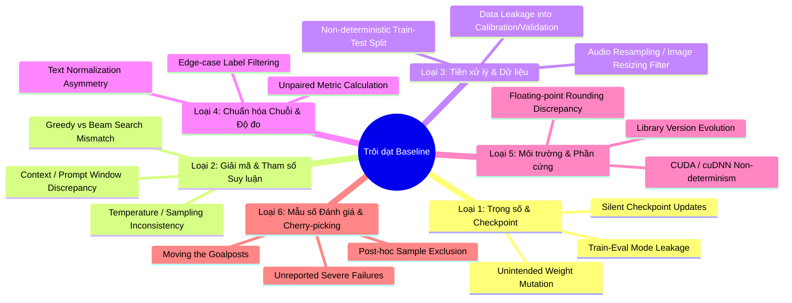

# KHUNG CHUẨN QUY TOÀN DIỆN VỀ KHÓA BASELINE VÀ CHỐNG TRÔI DẠT KẾT QUẢ TRONG NGHIÊN CỨU KHOA HỌC AI / ML
## (Universal Baseline Locking & Anti-Drift Protocol for AI/ML Academic Research)

> **Mã chuẩn quy:** `STD-RES-ANTI-DRIFT-UNIVERSAL-V1`  
> **Phạm vi áp dụng:** Mọi bài báo khoa học thực nghiệm trong các lĩnh vực AI, Deep Learning, Speech, NLP, Computer Vision (NeurIPS, ICML, ICLR, Interspeech, ICASSP, ACL, CVPR).  
> **Mục tiêu:** Triệt tiêu hoàn toàn hiện tượng lệch baseline (Baseline Deviation), trôi dạt điểm chuẩn (Baseline Drift), rò rỉ dữ liệu (Data Leakage) và tối ưu hóa hậu nghiệm (p-hacking / post-hoc cherry-picking), bảo đảm 100% tính tái lập (Reproducibility) và độ tin cậy khoa học cao nhất.

---

## 1. NGUY CƠ TRÔI DẠT BASELINE TRONG NGHIÊN CỨU KHOA HỌC

### 1.1. Bản chất của hiện tượng "Trôi dạt Baseline" (Baseline Drift)
Trong nghiên cứu học máy thực nghiệm, mục tiêu cốt lõi thường là chứng minh phương pháp đề xuất $\mathcal{M}_{\text{proposed}}$ vượt trội hơn phương pháp nền tảng $\mathcal{M}_{\text{baseline}}$ một lượng cải thiện $\Delta$:
$$\Delta = \text{Metric}(\mathcal{M}_{\text{proposed}}) - \text{Metric}(\mathcal{M}_{\text{baseline}})$$

**Hiện tượng trôi dạt baseline xảy ra khi giá trị $\text{Metric}(\mathcal{M}_{\text{baseline}})$ bị thay đổi âm thầm giữa các lần đo đạc** do sự không nhất quán trong môi trường thực nghiệm, tiền xử lý, tham số suy luận, hoặc định dạng đánh giá. 

Khi baseline bị trôi:
- Mọi con số cải thiện $\Delta$ đều **vô giá trị về mặt khoa học**.
- Cải thiện có thể chỉ là ảo giác sinh ra do baseline chạy ở cấu hình suy giảm (sub-optimal/degraded baseline), trong khi phương pháp đề xuất được hưởng lợi từ tiền xử lý hoặc tinh chỉnh tốt hơn.
- Bài báo đối mặt với nguy cơ bị từ chối thẳng thừng (Desk Reject) hoặc bị rút bài (Retraction) khi reviewer phát hiện không thể tái lập baseline gốc.

---

### 1.2. Phân loại 6 Hình thức Trôi dạt Baseline Phổ biến (Taxonomy of Drift)



---

## 2. KHUNG 7 TRỤ CỘT BẢO VỆ BASELINE BẤT BIẾN (THE 7-PILLAR FRAMEWORK)

Mọi bài báo khoa học chất lượng cao cần xây dựng một "hàng rào thép" gồm 7 trụ cột sau trước khi bắt đầu thu thập số liệu:

```
+-----------------------------------------------------------------------------------+
|               KHUNG 7 TRỤ CỘT BẢO VỆ LIÊM CHÍNH BASELINE KHOA HỌC                 |
+-----------------------------------------------------------------------------------+
| Trụ cột 1: HỢP ĐỒNG KHÓA CHECKPOINT (Immutable Checkpoint Pinning)                 |
| Trụ cột 2: GIAO THỨC SUY LUẬN GHÉP ĐÔI (Strict Paired-Sample Inference)           |
| Trụ cột 3: KHÓA BĂM DỮ LIỆU WORM (Cryptographic Data & Split Locking)             |
| Trụ cột 4: CHUẨN HÓA VÀ ĐỘ ĐO ĐƠN NHẤT (Canonical Normalization & Scoring)        |
| Trụ cột 5: BẢO VỆ DỮ LIỆU SẠCH / KHÔNG BIẾN DẠNG (Zero-Degradation Contract)       |
| Trụ cột 6: KIỂM ĐỊNH THỐNG KÊ GHÉP ĐÔI (Rigorous Paired Hypothesis Testing)       |
| Trụ cột 7: BIÊN BẢN WORM BẤT KHẢ BIẾN (Immutable Audit Trail & Receipts)          |
+-----------------------------------------------------------------------------------+
```

---

### Trụ cột 1: Hợp đồng Khóa Checkpoint & Kiến trúc (Immutable Checkpoint Pinning)
1. **Khóa Commit SHA duy nhất:** Tuyệt đối không sử dụng các nhãn động như `@latest`, `v1`, hoặc tên model chung chung (`whisper-base`, `bert-base-uncased`, `resnet50`). Bắt buộc phải khóa cứng Git Commit Hash hoặc HuggingFace Revision Hash:
   ```python
   # ĐÚNG: Khóa cứng revision hash
   model = AutoModel.from_pretrained("openai/whisper-base", revision="e08253a")
   
   # SAI: Dễ bị trôi dạt khi tác giả cập nhật checkpoint
   model = AutoModel.from_pretrained("openai/whisper-base")
   ```
2. **Khóa đóng băng toàn diện:**
   - Đặt toàn bộ tham số: `param.requires_grad = False`.
   - Bắt buộc kích hoạt chế độ đánh giá: `model.eval()`.
   - Vô hiệu hóa mọi tính năng ngẫu nhiên hóa khi suy luận: Tắt hoàn toàn Dropout, vô hiệu hóa việc cập nhật thống kê running mean/variance của BatchNorm.

---

### Trụ cột 2: Giao thức Suy luận Ghép đôi (Strict Paired-Sample Inference)
Nguyên tắc vàng: **Không bao giờ chạy Baseline và Proposed Method ở hai quy trình độc lập rồi gom điểm trung bình lại so sánh.**

1. **Thực thi Ghép đôi (Paired Execution):**
   Với mỗi mẫu dữ liệu $i$:
   $$\text{Sample } i \longrightarrow \begin{cases} \text{Audio / Image / Text} \\ \Downarrow \\ \hat{y}_{\text{baseline}}^{(i)} = \mathcal{M}_{\text{baseline}}(x^{(i)}; \Theta_{\text{shared}}) \\ \hat{y}_{\text{proposed}}^{(i)} = \mathcal{M}_{\text{proposed}}(x^{(i)}; \Theta_{\text{shared}}) \end{cases} \longrightarrow \Delta^{(i)} = \mathcal{L}(\hat{y}_{\text{proposed}}^{(i)}, y^{(i)}) - \mathcal{L}(\hat{y}_{\text{baseline}}^{(i)}, y^{(i)})$$
2. **Đồng nhất hóa Siêu tham số Giải mã (Decoding Parameters):**
   - **Greedy Search mặc định:** Đặt `temperature = 0.0`, `num_beams = 1`, `do_sample = False`. Nếu dùng Beam Search, số beam và độ phạt độ dài (length penalty) giữa hai bên phải giống hệt nhau $100\%$.
   - **Ngữ cảnh (Context Conditioning):** Không cho phép một bên được tiếp cận thông tin lịch sử (history/context window) còn bên kia thì không. Với speech/LLM, phải đặt `condition_on_previous_text = False` hoặc quy định độ dài context window cố định.
   - **Seed ngẫu nhiên:** Nếu bài toán bắt buộc dùng sampling, seed ngẫu nhiên trên CPU/GPU phải được reset giống nhau tại đầu mỗi mẫu:
     ```python
     torch.manual_seed(sample_id)
     torch.cuda.manual_seed_all(sample_id)
     ```

---

### Trụ cột 3: Khóa Băm Dữ liệu WORM (Cryptographic Data & Split Locking)
1. **Phân chia Phân vùng Xác định (Deterministic Partitioning):**
   - Việc chia tập Train, Validation, Test, Calibration phải dựa trên hàm băm mật mã học (Cryptographic Hash) kèm seed cố định, ví dụ:
     $$\text{Split}(ID) = \text{SHA256}(\text{seed} \,\|\, \text{corpus} \,\|\, ID) \pmod K$$
   - Tuyệt đối không chia ngẫu nhiên bằng `train_test_split(..., random_state=None)`.
2. **Khóa danh sách Manifest:**
   - Mọi danh sách file kiểm thử phải được lưu dưới dạng manifest tĩnh (`.jsonl` hoặc `.csv`).
   - Tạo tệp `checksums.sha256` ghi lại mã băm của tất cả manifest. Bất kỳ sự thêm, bớt hoặc đổi tên file nào trong tập dữ liệu đều bị phát hiện ngay lập tức:
     ```bash
     sha256sum data/manifests/*.jsonl > data/manifests/checksums.sha256
     sha256sum -c data/manifests/checksums.sha256
     ```
3. **Quy tắc Tách biệt Dữ liệu (Strict Anti-Leakage):**
   - **Cấm tiệt Blind Test Snooping:** Không bao giờ nạp tập Test vào quá trình tiền huấn luyện, chọn tham số (hyperparameter tuning), hiệu chuẩn (conformal calibration) hay chọn ngưỡng.
   - Tập kiểm thử đích (Target Test Data) chỉ được mở ra ở bước cuối cùng sau khi mọi tham số của phương pháp đã được đóng băng hoàn toàn.

---

### Trụ cột 4: Chuẩn hóa và Độ đo Đơn nhất (Canonical Normalization & Scoring)
1. **Bộ chuẩn hóa Văn bản / Nhãn duy nhất (Single Canonical Normalizer):**
   - Sự khác biệt nhỏ trong chuẩn hóa chuỗi (ví dụ: `don't` vs `do not`, cách xử lý dấu câu, chữ hoa/chữ thường, ký tự khoảng trắng) có thể làm thay đổi từ $1\%$ đến $5\%$ điểm số WER/BLEU/ROUGE.
   - Cả nhãn gốc (Ground Truth) và câu dự đoán của **mọi mô hình** bắt buộc phải đi qua đúng **một hàm chuẩn hóa duy nhất** được lưu trong mã nguồn.
2. **Quy tắc xử lý Nhãn Nhiễu & Mẫu Hỏng:**
   - Quy tắc loại trừ mẫu phải được định nghĩa **tiền nghiệm (a priori)** trước khi chạy, không được loại trừ **hậu nghiệm (post hoc)** sau khi thấy kết quả xấu.
   - Nếu dữ liệu chứa mẫu không xác định (unintelligible / corrupted), tài liệu phải nêu rõ quy tắc lọc (ví dụ: loại bỏ nhãn `xxx`, bỏ qua đoạn audio thiếu transcript) và báo cáo số lượng mẫu bị loại trừ trong báo cáo.

---

### Trụ cột 5: Hợp đồng Bảo vệ Dữ liệu Chuẩn (Zero-Degradation on Clean Data)
Một phương pháp adapter / tiền xử lý / sửa lỗi tốt **không được phép làm hỏng những gì vốn đã tốt**:
$$\Delta \text{Error}_{\text{clean}} = \text{Error}(\mathcal{M}_{\text{proposed}}) - \text{Error}(\mathcal{M}_{\text{baseline}}) \le 0.00\%$$

- **Cơ chế Hoàn nguyên Danh tính (Identity Fallback):** Khi gặp mẫu chuẩn (in-distribution / clean data), hệ thống phải nhận diện được và trả về nguyên trạng kết quả của baseline ($f(x) \equiv x$).
- **Kiểm thử Bit-Exact Identity:** Đối với các khung hình / biểu diễn không cần sửa đổi, sai số tensor giữa baseline và adapter phải bằng $0$ tuyệt đối:
  $$\max |h_{\text{proposed}} - h_{\text{baseline}}| = 0.000000$$

---

### Trụ cột 6: Kiểm định Thống kê Ghép đôi (Rigorous Paired Hypothesis Testing)
Không bao giờ kết luận phương pháp vượt trội chỉ dựa trên một số đo trung bình (Point Estimate).

1. **Kiểm định Thống kê Phi tham số:**
   - Sử dụng **Wilcoxon Signed-Rank Test** cho các cặp mẫu ghép đôi trên từng speaker / utterance:
     $$\text{Reject } H_0 \iff p\text{-value} < 0.05 \text{ (hoặc } 0.01\text{)}$$
2. **Khoảng tin cậy Bootstrap (Bootstrap Confidence Intervals):**
   - Tính khoảng tin cậy $95\%$ cho mức cải thiện $\Delta$ bằng kỹ thuật Paired Clustered Bootstrap ($B \ge 1{,}000$ iterations).
   - Nếu cận trên của khoảng tin cậy của $\Delta$ vượt quá $0$, kết quả phải được báo cáo là **Inconclusive (Chưa đủ bằng chứng thống kê)**, không được tuyên bố thắng cuộc tuyệt đối.
3. **Hiệu chỉnh Kiểm định Đa biến (Multiple Testing Correction):**
   - Khi so sánh trên nhiều tập dữ liệu con hoặc nhiều phân nhóm, phải áp dụng **Benjamini-Hochberg (BH) False Discovery Rate (FDR)** để tránh dương tính giả do kiểm định nhiều lần.

---

### Trụ cột 7: Biên bản Chống Gian lận WORM (Immutable Audit Trail & Receipts)
Để phục vụ quá trình bình duyệt (Peer Review) minh bạch, mỗi lượt chạy thực nghiệm phải tự động sinh ra một biên bản kiểm toán dạng JSON bất khả biến (Write-Once-Read-Many):

```json
{
  "worm_receipt_version": "1.0",
  "timestamp_utc": "2026-10-18T05:15:00Z",
  "provenance": {
    "git_commit": "4242f89a9f24",
    "git_branch": "main",
    "code_bundle_sha256": "7a8b9c... (hash của toàn bộ mã nguồn)",
    "data_manifest_sha256": "e3b0c4... (hash của danh sách mẫu)",
    "model_checkpoint_sha256": "f5a6b7... (hash trọng số mô hình)"
  },
  "environment": {
    "pytorch_version": "2.5.1+cu121",
    "cuda_device": "NVIDIA RTX 6000 Ada Generation",
    "os_platform": "Linux-5.15.0-x86_64",
    "cudnn_deterministic": true
  },
  "decoding_protocol": {
    "decoding_mode": "greedy",
    "temperature": 0.0,
    "num_beams": 1,
    "normalizer_id": "canonical_v1"
  },
  "paired_results": {
    "num_samples_evaluated": 1500,
    "baseline_metric": 32.40,
    "proposed_metric": 29.80,
    "delta_metric": -2.60,
    "relative_improvement_werr": 8.02,
    "wilcoxon_p_value": 0.00042,
    "bootstrap_95ci": [-3.45, -1.75]
  }
}
```

---

## 3. CHECKLIST 8 ĐIỂM TIỀN THỰC NGHIỆM DÀNH CHO MỌI BÀI BÁO (PRE-FLIGHT CHECKLIST)

Trước khi thực hiện benchmark cuối cùng để đưa số liệu vào bài báo, mọi tác giả/kỹ sư cần tick đủ 8 mục:

| STT | Hạng mục kiểm tra | Tiêu chuẩn đạt | Xác nhận |
| :---: | :--- | :--- | :---: |
| **1** | **Khóa Trọng số** | Mô hình baseline đã gọi `.eval()`, `requires_grad=False`, pinned commit hash. | [ ] |
| **2** | **Khóa Tiền xử lý** | Input audio/image/text đi qua cùng một hàm pipeline tiền xử lý và tokenizer giống nhau $100\%$. | [ ] |
| **3** | **Khóa Tham số Giải mã** | Greedy mode (`temp=0`, `beam=1`), vô hiệu hóa prompt/context rò rỉ. | [ ] |
| **4** | **Khóa Dữ liệu Manifest** | Mọi file dữ liệu có mã SHA256 nằm trong `checksums.sha256`, không trùng lặp giữa Train/Val/Test. | [ ] |
| **5** | **Khóa Bộ Chuẩn hóa** | Hàm chuẩn hóa duy nhất xử lý đồng bộ ground-truth và dự đoán của tất cả các mô hình. | [ ] |
| **6** | **Thực thi Ghép đôi** | Kết quả được ghi nhận từng cặp cho từng mẫu ($x^{(i)} \to (\hat{y}_{\text{base}}, \hat{y}_{\text{prop}})$) trong cùng lần chạy. | [ ] |
| **7** | **Bảo toàn Tập Chuẩn** | Sai số trên tập chuẩn (in-distribution / clean) $\Delta \le 0.00\%$, identity fallback kích hoạt đúng thiết kế. | [ ] |
| **8** | **Ký Biên bản WORM** | Tệp biên bản `worm_receipt_*.json` được sinh tự động và lưu trữ bất biến kèm commit hash. | [ ] |

---

## 4. HƯỚNG DẪN CỤ THỂ HÓA CHO TỪNG CHUYÊN NGÀNH

### 4.1. Lĩnh vực Nhận dạng Tiếng nói (Speech Recognition / ASR)
- **Điểm nóng gây lệch:** Khác biệt giữa các kênh micro (Table Mic vs Headset Mic), tần số lấy mẫu (8kHz vs 16kHz resample anti-aliasing), Whisper Normalizer vs Interspeech Normalizer, nhãn chú thích phi ngôn ngữ (`[laughter]`, `[cough]`, `xxx`).
- **Yêu cầu bắt buộc:** Khóa cố định 1 kênh âm thanh duy nhất theo hợp đồng dữ liệu; dùng chung một hàm `normalize_text_v1` để tính WER/CER; không dùng `condition_on_previous_text=True` khi đánh giá từng câu độc lập.

### 4.2. Lĩnh vực Xử lý Ngôn ngữ Tự nhiên & LLM (NLP / LLMs)
- **Điểm nóng gây lệch:** Prompt template (khoảng trắng, ký tự ngắt dòng `\n`), system prompt bí mật, quantization rounding (FP16 vs INT8 vs INT4), chat template khác nhau giữa các thư viện.
- **Yêu cầu bắt buộc:** Khóa cứng raw prompt string; tắt sampling (`do_sample=False`, `temperature=0.0`); cố định max new tokens; dùng exact tokenizer từ checkpoint pinned.

### 4.3. Lĩnh vực Thị giác Máy tính (Computer Vision / CV)
- **Điểm nóng gây lệch:** Hàm resize ảnh (`PIL.Image.BILINEAR` vs `cv2.INTER_LINEAR` vs `torchvision.transforms.InterpolationMode.BICUBIC`), chuẩn hóa màu ảnh (ImageNet mean/std vs $[0, 1]$), IoU threshold trong NMS.
- **Yêu cầu bắt buộc:** Đóng gói pipeline transforms vào một file độc lập; khóa toàn bộ thông số crop/resize; đo đạc mAP bằng chung một bộ công cụ chuẩn hóa (ví dụ: pycocotools chính thức).

---

## 5. KẾT LUẬN & CAM KẾT KHOA HỌC

Một bài báo khoa học có giá trị vĩnh viễn không phải là bài báo có con số SOTA cao nhất bằng mọi giá, mà là bài báo có **phương pháp luận vững chắc, baseline trung thực, và kết quả hoàn toàn có thể tái lập**. 

Tuân thủ Khung Chuẩn quy Toàn diện này là bảo chứng cao nhất giúp công trình khoa học vượt qua mọi quy trình phản biện khắt khe nhất tại các hội nghị học thuật hàng đầu thế giới.
